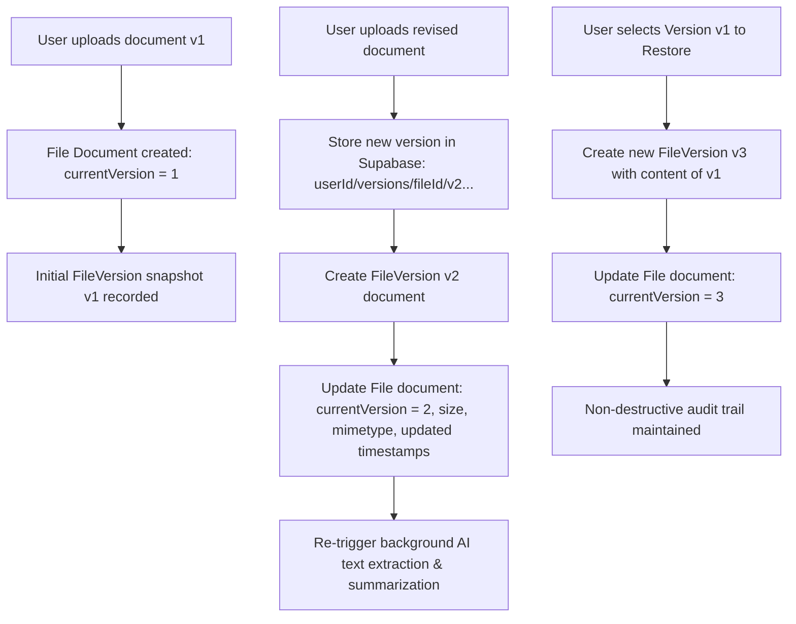
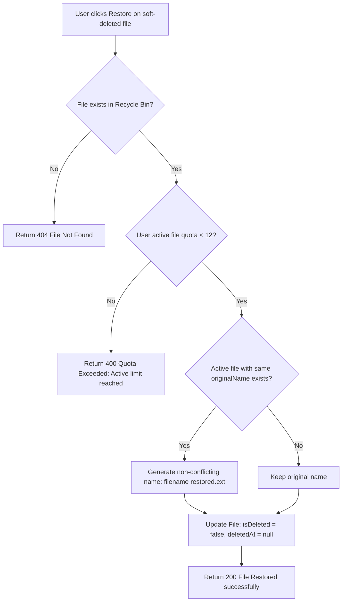

# 📜 VaultMind — File Version History & Recycle Bin Technical Design Plan

**Document ID**: `docs/file-version-history-recycle-bin-plan.md`  
**Authors**: Senior Software Engineering Agent (Antigravity)  
**Creation Date**: 2026-10-16  
**Target Repository**: `https://github.com/develo-oper-piyush/VaultMind`  
**Target Branch**: `feature/file-version-history-recycle-bin`  
**Status**: Approved Architecture & Specification (Day 1)  

---

## Executive Summary

VaultMind is an AI-powered document workspace and cloud storage solution designed to provide semantic search, generative summarization, and interactive retrieval-augmented generation (RAG) over stored documents. As user adoption grows, two critical data protection and lifecycle features are required:

1. **Feature 1: File Version History**: Enables users to upload revised iterations of documents without losing previous versions. Users can inspect historical versions, download any previous snapshot, review file metadata deltas, and restore an earlier iteration (which safely creates a new latest version without mutating audit history).
2. **Feature 2: Recycle Bin (Soft Delete & Recovery)**: Eliminates accidental permanent data loss by transitioning file deletions to a soft-deleted holding state. Users can inspect soft-deleted assets, restore them to their active workspace with automated conflict resolution, or permanently purge them when desired, with full cascade cleanup across Supabase storage, MongoDB metadata, version archives, and document RAG chunks.

This document lays down the technical blueprint, architectural integration points, security guarantees, API and UI contracts, testing strategy, and seven-day calendar roadmap.

---

## A. Repository Audit

### A.1 Verified Technology Stack

| Layer | Technology | Version | Location / Details |
|---|---|---|---|
| **Runtime** | Node.js | v20+ recommended | Root / Docker containers |
| **Backend Framework** | Express.js | `^5.2.1` | `Backend/app.js`, `Backend/package.json` |
| **Database & ODM** | MongoDB Atlas with Mongoose | `^9.1.3` | `Backend/models/`, `Backend/config/db.js` |
| **Object Storage** | Supabase Storage (S3-compatible) | `@supabase/supabase-js ^2.90.1` | Bucket `Files-upload`, `Backend/config/supabase.js` |
| **AI & LLM Services** | Google Gemini Generative AI | `@google/generative-ai ^0.24.1` | `Backend/utils/aiTagger.js`, `aiSummarizer.js` |
| **File Parsing & RAG** | `pdf-parse`, `mammoth`, text chunking | `pdf-parse ^2.4.5`, `mammoth ^1.12.1` | `Backend/utils/textExtractor.js`, `documentChunk.model.js` |
| **Authentication** | JWT (`jsonwebtoken ^9.0.3`) + HTTP-only cookies | `cookie-parser ^1.4.7`, `bcrypt ^6.0.0` | `Backend/middlewares/auth.middleware.js` |
| **Frontend Framework** | Next.js (App Router) + React | Next `16.3.3`, React `19.2.8` | `Frontend/app/`, `Frontend/package.json` |
| **Language** | TypeScript | `^5.0.0` | `Frontend/tsconfig.json` |
| **Styling & UI Kit** | Tailwind CSS v4, DaisyUI v5, Radix UI Icons | `@tailwindcss/postcss ^4`, `daisyui ^5.7.22` | `Frontend/components/`, `Frontend/app/globals.css` |
| **Animation & UX** | GSAP, Motion, Lenis, OGL | `motion ^13.1.1`, `gsap ^3.15.0` | `Frontend/components/` |
| **Containerization** | Docker & Docker Compose | Compose file version 3.8 | `docker-compose.yml`, `docker-compose.dev.yml` |

### A.2 Existing File Management Architecture

The current file lifecycle operates as follows:
1. **User Storage Boundaries**: Each user can store up to `MAX_FILES_PER_USER = 12` files, with each individual file capped at `MAX_FILE_SIZE = 5MB` (`Backend/routes/index.routes.js:16-17`).
2. **Object Path Convention**: Uploaded files reside in the Supabase bucket `Files-upload` under the path `{userId}/{fileName}`, where `fileName` is prefixed with an upload millisecond timestamp (`${Date.now()}-${file.name}`).
3. **Workspace Retrieval (`GET /files/home`)**:
   - Queries Supabase bucket: `supabase.storage.from("Files-upload").list(userId)`.
   - Fetches MongoDB metadata: `File.find({ userId }).lean()`.
   - Merges object listings with MongoDB document metadata to produce the file list presented to the client.
4. **File Upload (`POST /files/upload-file`)**:
   - Validates file presence, 5MB limit, and user file count.
   - Uploads binary data to Supabase Storage.
   - Creates a document in MongoDB `File` collection.
   - Triggers asynchronous background AI processing (`processFileInBackground`) for text extraction, keywords, tags, and summary.
5. **Direct Deletion (`POST /files/delete-file`)**:
   - Executes hard deletion: calls `supabase.storage.from("Files-upload").remove([filePath])`.
   - Removes MongoDB document: `File.deleteOne({ userId, fileName })`.
   - Does not maintain version history or a recovery buffer.

### A.3 Relevant Source Files and Responsibilities

- `Backend/app.js`: Application entry point; registers middleware, CORS, cookie parser, file-upload parser, and route prefixes (`/files`, `/api/files`, `/user`, `/api/user`).
- `Backend/routes/index.routes.js`: Implements core file endpoints (`/home`, `/upload-file`, `/delete-file`, `/rename-file`, `/view-file/:fileName`, `/secure-file/:fileName`, `/search`, `/file-status/:fileId`).
- `Backend/models/file.model.js`: Mongoose schema for file metadata (`userId`, `fileName`, `originalName`, `supabasePath`, `mimetype`, `size`, `textContent`, `keywords`, `tags`, `category`, `summary`, `chunkCount`, `processingStatus`).
- `Backend/models/documentChunk.model.js`: Schema for RAG document chunks (`fileId`, `chunkIndex`, `text`, `keywords`, `metadata`).
- `Backend/middlewares/auth.middleware.js`: Authorizes requests using JWT from cookie or Bearer header; populates `req.user.userId`.
- `Backend/config/supabase.js`: Initializes Supabase client with service role credentials.
- `Backend/config/db.js`: MongoDB Atlas connection manager with DNS fallbacks.
- `Frontend/lib/api.ts`: Central HTTP client wrapping all backend endpoints with credential propagation.
- `Frontend/types/index.ts`: Shared TypeScript interfaces (`FileItem`, `FilesResponse`, `SearchResult`, etc.).
- `Frontend/app/dashboard/page.tsx`: Main user dashboard; controls file cards, search, type and category filters, sorting, and upload operations.
- `Frontend/components/FileCard.tsx`: Interactive card rendering file attributes, status badges, contextual dropdown actions (open, copy link, rename, delete).

### A.4 Existing Storage and Database Approach

- **Storage**: Single Supabase bucket `Files-upload`. Files stored flat inside user directory `{userId}/{fileName}`. Signed URLs generated on-demand (`/view-file/:fileName`) or streamed directly via authenticated endpoint (`/secure-file/:fileName`).
- **Database**: MongoDB with Mongoose. Primary collection `files` with compound index `{ userId: 1, createdAt: -1 }` and text index `{ textContent: "text", keywords: "text", fileName: "text" }`.
- **RAG Chunks**: Chunks saved in `documentchunks` collection with `{ userId: 1, fileId: 1, chunkIndex: 1 }`.

### A.5 Current Test and Build Commands

- Backend:
  - Development: `npm run dev` (`npx nodemon app.js`)
  - Start: `npm start`
  - Current test script: `echo "Error: no test specified" && exit 1`
- Frontend:
  - Development: `npm run dev` (`next dev`)
  - Build: `npm run build` (`next build`)
  - Linting: `npm run lint` (`eslint`)

### A.6 Blockers and Assumptions

- **Assumptions**:
  - The application relies on Supabase Storage bucket `Files-upload`. Version files will use the same bucket under a clean namespaced folder structure: `{userId}/versions/{fileId}/v{versionNumber}_{timestamp}-{originalName}` to prevent collision with root user files.
  - Soft-deleted files will remain at their original Supabase path `{userId}/{fileName}` during the retention window, marked with `isDeleted: true` in MongoDB. This prevents expensive storage moves/copies upon deletion and restoration.
  - Hard deletion cascades across: current storage object, all historical version storage objects, MongoDB `File` document, all `FileVersion` documents, and all associated `DocumentChunk` documents.
- **Identified Risks**:
  - `GET /files/home` currently iterates Supabase objects first. If a file is soft-deleted, it still exists in the Supabase bucket. Therefore, `GET /files/home` must filter files against MongoDB metadata to strictly exclude any file marked `isDeleted: true`.
  - Quota calculations: If a user has a 12-file limit, soft-deleted files should either count towards a separate trash quota or temporarily release the active slot while occupying storage until purged. Active slot calculation must count only `isDeleted: false`.

---

## B. File Version History Design

### B.1 Overview & Version Lifecycle

File Version History provides complete lineage tracking for modified documents. Every time a user updates a file with a new revision, the current state is preserved as an immutable snapshot in version history, and the new upload becomes the active working version.



### B.2 Creation of the Initial Version

- When a file is uploaded for the first time via `POST /files/upload-file`:
  1. The base `File` document is inserted into MongoDB with `currentVersion: 1`, `totalVersions: 1`.
  2. A matching `FileVersion` document is created referencing `fileId`, `versionNumber: 1`, storage path, checksum/size, and creator metadata.
  3. For backward compatibility with existing files uploaded before this feature, any file lacking an explicit `FileVersion` record will have its Version 1 lazily backfilled on-the-fly when its version history is first queried.

### B.3 Preserving Previous Content on Updates

- To upload a new version, a dedicated endpoint `POST /files/:fileId/version` is introduced.
- **Workflow**:
  1. Authenticate user and confirm ownership of `fileId` (`userId === req.user.userId`).
  2. Ensure the file is not currently in the Recycle Bin (`isDeleted !== true`).
  3. Validate new file binary (must not exceed `MAX_FILE_SIZE = 5MB`).
  4. Generate a unique namespaced storage path:
     `{userId}/versions/{fileId}/v{nextVersion}_{Date.now()}-{sanitizedOriginalName}`
  5. Upload the revision binary to Supabase Storage.
  6. Calculate `nextVersion = file.currentVersion + 1`.
  7. Insert a new `FileVersion` record with `versionNumber: nextVersion`.
  8. Update the primary `File` document:
     - `fileName`: updated storage filename.
     - `supabasePath`: new active storage path.
     - `size`: new file size.
     - `mimetype`: new mimetype.
     - `currentVersion`: `nextVersion`.
     - `totalVersions`: `nextVersion`.
     - `updatedAt`: `new Date()`.
     - Reset `processingStatus` flags to trigger AI extraction for the new content.
  9. Trigger asynchronous background AI text processing for the new version.

### B.4 Proposed Version Metadata & Schema

A new Mongoose schema and model: `Backend/models/fileVersion.model.js`:

```javascript
const mongoose = require("mongoose");

const fileVersionSchema = new mongoose.Schema({
    fileId: {
        type: mongoose.Schema.Types.ObjectId,
        ref: "File",
        required: true,
        index: true,
    },
    userId: {
        type: String,
        required: true,
        index: true,
    },
    versionNumber: {
        type: Number,
        required: true,
    },
    originalName: {
        type: String,
        required: true,
    },
    storagePath: {
        type: String,
        required: true,
    },
    mimetype: {
        type: String,
        required: true,
    },
    size: {
        type: Number,
        required: true,
    },
    changeSummary: {
        type: String,
        default: "Updated file content",
        trim: true,
        maxlength: 300,
    },
    summarySnapshot: {
        type: String,
        default: null,
    },
    tagsSnapshot: {
        type: [String],
        default: [],
    },
    createdBy: {
        type: String,
        required: true,
    },
    createdAt: {
        type: Date,
        default: Date.now,
    },
});

// Compound unique index ensuring version numbers are unique per file
fileVersionSchema.index({ fileId: 1, versionNumber: 1 }, { unique: true });
fileVersionSchema.index({ userId: 1, createdAt: -1 });

module.exports = mongoose.model("FileVersion", fileVersionSchema);
```

### B.5 Historical Content Storage and Retrieval

- Historical files are stored in Supabase under `{userId}/versions/{fileId}/...`.
- Endpoints:
  - `GET /files/:fileId/versions`: Returns all version records ordered by `versionNumber: -1`.
  - `GET /files/:fileId/versions/:versionId/download`: Validates user ownership, fetches the historical storage binary from Supabase, sets `Content-Disposition: attachment; filename="{originalName}"`, and streams the file securely to the client.

### B.6 Non-Destructive Version Restoration

When a user requests to restore an earlier Version $K$:
1. The system does **not** delete newer versions or rewind timestamps.
2. The binary from Version $K$'s storage path is retrieved from Supabase.
3. A new version number $N+1$ is allocated (`nextVersion = file.currentVersion + 1`).
4. The content of Version $K$ is stored as the new Version $N+1$.
5. A new `FileVersion` entry is created with `changeSummary: "Restored from Version K"`.
6. The primary `File` metadata is updated to point to this new version.
7. This adheres strictly to immutable audit logging principles: historical versions remain intact forever.

### B.7 Concurrency and Failure Handling

- **Optimistic Locking**: The `File` document utilizes Mongoose version keys (`__v`) or atomic conditional updates:
  `File.findOneAndUpdate({ _id: fileId, userId, currentVersion: expectedVersion }, { ... })`
  If another request updated the version concurrently, the update fails with `409 Conflict`, prompting the client to refresh.
- **Compensating Rollbacks**: If Supabase upload succeeds but MongoDB persistence fails, an asynchronous cleanup removes the orphaned Supabase object.

### B.8 Access Control

- All version endpoints verify the requesting user's identity (`req.user.userId`).
- Any query to `FileVersion` includes `{ userId: req.user.userId, fileId }`.
- Cross-user file access attempts yield `404 Not Found` or `403 Forbidden`.

---

## C. Recycle Bin Design

### C.1 Soft Deletion & Metadata Tracking

Instead of immediately destroying files, file deletion defaults to a safe, recoverable soft delete.

#### Schema Updates to `Backend/models/file.model.js`:
```javascript
// New fields added to fileSchema:
isDeleted: {
    type: Boolean,
    default: false,
    index: true,
},
deletedAt: {
    type: Date,
    default: null,
},
deletionExpiresAt: {
    type: Date,
    default: null,
    index: true, // For automated TTL or query filtering
},
deletedBy: {
    type: String,
    default: null,
},
```

#### Soft Deletion Workflow (`POST /files/delete-file` or `POST /files/:fileId/trash`):
1. User clicks "Move to Trash" / "Delete" in the UI.
2. Backend verifies ownership (`_id: fileId, userId: req.user.userId, isDeleted: false`).
3. Updates `File` record:
   - `isDeleted: true`
   - `deletedAt: new Date()`
   - `deletionExpiresAt: new Date(Date.now() + 30 * 24 * 60 * 60 * 1000)` (30-day retention window)
   - `deletedBy: req.user.userId`
4. The storage object in Supabase is **not** deleted yet; it remains safely preserved.
5. RAG indexing status: Chunks in `DocumentChunk` remain associated but are excluded from active search and chat retrievals using an `isDeleted` check on the parent file.

### C.2 Exclusion from Normal Listings

- **Active File Listing (`GET /files/home`)**:
  - The query for metadata strictly filters: `File.find({ userId, isDeleted: { $ne: true } })`.
  - Supabase files listed that correspond to `isDeleted: true` are filtered out from the response payload.
  - Active file count (`fileCount`) considers only non-deleted files, freeing up the user's active 12-file workspace quota.
- **Search (`POST /files/search`)**:
  - Semantic and text queries strictly include `{ isDeleted: { $ne: true } }`.
- **Document Chat (`POST /chat/ask`)**:
  - Retrieval pipeline filters out chunks belonging to files with `isDeleted: true`.

### C.3 Recycle Bin Listing (`GET /files/recycle-bin`)

- Returns all files for the user where `isDeleted: true`.
- Enriched response includes:
  - File details (`_id`, `originalName`, `size`, `mimetype`, `category`, `tags`).
  - `deletedAt` timestamp.
  - Calculated `daysRemaining` before automatic permanent purge:
    `Math.max(0, Math.ceil((deletionExpiresAt - Date.now()) / (1000 * 60 * 60 * 24)))`.
  - `versionCount`: Number of associated historical versions.

### C.4 Restoration Workflow & Conflict Resolution

Restoration endpoint: `POST /files/recycle-bin/:fileId/restore`.



- **Quota Enforcement**: If the active workspace already has 12 files, restoration is blocked until a file is removed or soft-deleted, preventing quota bypass.
- **Name Conflict Handling**: If an active file exists with identical `originalName`:
  - Strategy: Append a deterministic suffix: `basename (restored).extension` or `basename (restored YYYY-MM-DD).extension`.
  - The response notifies the client of any name change applied during restoration.

### C.5 Permanent Deletion & Storage Cleanup

Permanent deletion endpoint: `DELETE /files/recycle-bin/:fileId` (or bulk `POST /files/recycle-bin/empty`).
- **Cascade Deletion Steps**:
  1. Verify the file belongs to `req.user.userId` and has `isDeleted: true`.
  2. Retrieve all `FileVersion` entries for this `fileId`.
  3. Delete the active file binary from Supabase: `supabase.storage.from("Files-upload").remove([file.supabasePath])`.
  4. Delete all historical version storage objects from Supabase in batch:
     `supabase.storage.from("Files-upload").remove(versionPaths)`.
  5. Delete all `DocumentChunk` documents associated with this `fileId`.
  6. Delete all `FileVersion` documents associated with this `fileId`.
  7. Delete the primary `File` document from MongoDB.
  8. Return confirmation of complete cascade deletion.

### C.6 Version History Preservation in Recycle Bin

While a file resides in the Recycle Bin:
- Its `FileVersion` records remain untouched in MongoDB.
- Its version storage objects remain in Supabase.
- If restored, the file returns with its full version history completely intact.
- Version management actions (uploading new versions, restoring old versions) are disabled while a file is in the Recycle Bin.

### C.7 Authorization & Idempotency

- Repeated deletion or restoration calls are handled gracefully:
  - If a file is already deleted, trashing it again returns success (`already trashed`).
  - If a file is already active, restoring it returns success (`already active`).
- Cross-user attacks are blocked because all operations strictly filter by `userId: req.user.userId`.

---

## D. Proposed API and UI Changes

> [!NOTE]
> All endpoints listed below are **proposed specifications** to be implemented starting on Day 2/Day 3/Day 4. They are not yet present in the production codebase today.

### D.1 Proposed Backend Endpoints

#### File Version History Endpoints:
| Method | Endpoint | Auth | Description |
|---|---|:---:|---|
| `GET` | `/api/files/:fileId/versions` | Yes | List all historical versions for a file with metadata and change notes |
| `POST` | `/api/files/:fileId/versions` | Yes | Upload a new version for an existing file (multipart form data) |
| `GET` | `/api/files/:fileId/versions/:versionId/download` | Yes | Download the exact binary content of a historical version |
| `POST` | `/api/files/:fileId/versions/:versionId/restore` | Yes | Restore a historical version as the new latest version |

#### Recycle Bin Endpoints:
| Method | Endpoint | Auth | Description |
|---|---|:---:|---|
| `GET` | `/api/files/recycle-bin` | Yes | List all soft-deleted files with retention timers and version counts |
| `POST` | `/api/files/:fileId/trash` | Yes | Soft-delete a file (move to Recycle Bin) |
| `POST` | `/api/files/:fileId/restore` | Yes | Restore a soft-deleted file back to the active workspace |
| `DELETE` | `/api/files/recycle-bin/:fileId` | Yes | Permanently purge a file and all associated versions/chunks |
| `POST` | `/api/files/recycle-bin/empty` | Yes | Permanently purge all soft-deleted files for the user |

### D.2 Proposed Frontend Components & UI Additions

1. **Dashboard Navigation & View Toggle**:
   - Add a "Recycle Bin" tab / button in `Frontend/app/dashboard/page.tsx` header alongside Photos and Profile links.
   - Shows badge count of soft-deleted items (e.g., `Trash (3)`).
2. **FileCard Component Enhancements (`Frontend/components/FileCard.tsx`)**:
   - Add "Version History" option in the contextual dropdown menu with clock/history icon (`CounterClockwiseClockIcon`).
   - Display a subtle version badge (e.g., `v3`) on cards having multiple versions.
   - Change "Delete" action to "Move to Trash" with an informative toast and "Undo" shortcut.
3. **Version History Modal / Drawer (`Frontend/components/VersionHistoryModal.tsx`)**:
   - Modern glassmorphism dark-mode modal.
   - Chronological vertical timeline showing:
     - Version number tag (`v1`, `v2`, `v3 (Current)`).
     - Upload date & time formatted nicely.
     - File size and size difference compared to predecessor (+12 KB / -5 KB).
     - Change notes / summary.
     - Action buttons: "Download", "Restore to Latest" (disabled on current version).
     - Drag-and-drop / file selector zone to "Upload New Version".
4. **Recycle Bin View (`Frontend/app/dashboard/recycle-bin/` or Tab View)**:
   - Header with "Empty Recycle Bin" primary destructive button.
   - Grid or table of soft-deleted files displaying:
     - Original filename, category icon, and size.
     - "Deleted on" date and "Days remaining" badge (e.g., `28 days left`).
     - Actions: "Restore" button (with conflict resolution toast), "Delete Permanently" button.
5. **Confirmation Dialogs**:
   - `PermanentDeleteDialog.tsx`: Double-confirmation warning stating that permanent deletion is irreversible and deletes all version history.
   - `RestoreConflictDialog.tsx`: Displayed if a name collision occurs on restore, asking the user to choose "Restore as [name (restored)]" or cancel.

---

## E. Security and Data Integrity

### E.1 Authentication & Ownership Checks
- Every request must pass `authMiddleware`, decoding the JWT and establishing `req.user.userId`.
- No database query or Supabase storage interaction can occur without explicitly constraining `{ userId: req.user.userId }`.
- Any attempt to access a `fileId` or `versionId` belonging to another user must return `404 Not Found` (to avoid leaking resource existence).

### E.2 Safe Storage Paths and Anti-Traversal
- Storage paths are strictly generated on the server using validated IDs and sanitized names:
  `const sanitizedName = originalName.replace(/[^a-zA-Z0-9._-]/g, "_");`
- Direct client input is never concatenated into file paths without sanitization, preventing directory traversal attacks (`../`).

### E.3 Database & Storage Consistency
- **Two-Phase Upload Handling**: Supabase storage upload precedes database insertion. If database insertion throws, the newly created Supabase object is immediately deleted via compensating rollback.
- **Cascade Deletion**: When permanently deleting, Supabase objects for all versions are removed in batch before deleting MongoDB records. If storage removal fails, the transaction halts to prevent dangling orphan storage objects.

### E.4 Accidental Deletion Protection
- Two-tier deletion: files must first be soft-deleted before permanent deletion is allowed.
- Permanent deletion requires explicit user confirmation via modal dialog.
- Active workspace operations (`rename`, `update version`) reject files where `isDeleted === true`.

### E.5 Backward Compatibility & Migration Safety
- Schema additions (`isDeleted`, `deletedAt`, `currentVersion`) have safe default values (`false`, `null`, `1`).
- Queries using `{ isDeleted: { $ne: true } }` seamlessly treat existing un-migrated documents without the field as active.
- Non-breaking API extensions: existing `/files/home` and `/files/upload-file` continue working seamlessly without client regression.

---

## F. Testing Plan

### F.1 Unit Tests
- `versioning.test.js`:
  - Calculate `nextVersion` correctly (incrementing monotonically).
  - Version metadata normalization and change note trimming.
  - Restoration logic allocating new version number rather than rewinding.
- `recycleBin.test.js`:
  - Soft-delete status toggling and calculation of `deletionExpiresAt` (+30 days).
  - Name collision detection and auto-suffix generation (`file (restored).pdf`).
  - Quota verification (blocking restore when active file count $\ge 12$).

### F.2 Integration Tests
- **Version Flow**:
  1. Upload `document.txt` (v1).
  2. Upload revised `document.txt` (v2).
  3. Verify `GET /files/:fileId/versions` returns both versions with correct sizes and timestamps.
  4. Download v1 and verify byte-for-byte fidelity with original content.
  5. Restore v1; verify v3 is created with v1 content.
- **Recycle Bin Flow**:
  1. Move `document.txt` to trash; verify it disappears from `GET /files/home` and appears in `GET /files/recycle-bin`.
  2. Search for `document.txt`; verify search excludes it.
  3. Restore file; verify it reappears in `GET /files/home`.
  4. Move to trash again and trigger permanent delete; verify removal from MongoDB and Supabase.

### F.3 Authorization & Security Tests
- User B attempts to view or download User A's file versions $\rightarrow$ `404 Not Found`.
- User B attempts to restore or purge User A's trash item $\rightarrow$ `404 Not Found`.
- Unauthenticated requests to any version or trash endpoint $\rightarrow$ `401 Unauthorized`.

### F.4 Regression Tests
- Existing upload, rename, download, semantic search, and RAG document chat continue functioning without regression.

---

## G. Seven-Day Implementation Roadmap

| Day | Date (Local) | Phase Target | Expected Commit Message | Deliverables |
|:---:|:---:|---|---|---|
| **Day 1** | **2026-10-16** | Repository audit, branch setup & technical design | `docs: document file version history and recycle bin design` | Branch `feature/file-version-history-recycle-bin`, deep code audit, comprehensive technical architecture doc (`docs/file-version-history-recycle-bin-plan.md`) |
| **Day 2** | **2026-10-17** | Database models, indexes, migrations & backend foundation | `feat(models): add FileVersion schema and recycle bin fields to File` | `FileVersion` model, updated `File` schema (`isDeleted`, `deletedAt`, `currentVersion`), database indexes, and migration helpers |
| **Day 3** | **2026-10-18** | File Version History APIs & storage integration | `feat(api): implement file version upload, listing, download and restore` | Express routes for version upload, version listing, historical download, and non-destructive version restoration |
| **Day 4** | **2026-10-19** | Recycle Bin backend operations & safe cleanup | `feat(api): implement recycle bin soft delete, restore, and permanent purge` | Soft-delete routes, exclusion filters on `/files/home` and `/search`, restore endpoint with conflict resolution, cascade permanent purge |
| **Day 5** | **2026-10-20** | File Version History UI | `feat(ui): add version history modal, timeline, and upload controls` | React/Next.js `VersionHistoryModal`, timeline layout, size delta indicators, download and restore buttons in `FileCard` |
| **Day 6** | **2026-10-21** | Recycle Bin UI & dashboard integration | `feat(ui): add recycle bin tab, retention countdown, and purge dialogs` | Recycle Bin dashboard view, days-remaining badge, restore action with undo toast, permanent delete confirmation modal |
| **Day 7** | **2026-10-22** | Testing, security review, bug fixes, documentation & final validation | `test: add unit, integration and security tests for versioning and recycle bin` | End-to-end integration tests, edge-case hardening, security verification, final documentation update, and validation report |

> [!IMPORTANT]
> **Strict Daily Commit Rule**:
> - Exactly **one** commit per calendar day.
> - No simulated progress, backdating, or multi-commit batches on a single calendar day.
> - Today (Day 1: 2026-10-16) contains strictly the Day 1 documentation and branch setup.

---

## H. Implementation Progress Log

### Day 1 — 2026-10-16
- **Status**: Completed
- **Commit**: `7bfa97f` (`docs: document file version history and recycle bin design`)
- **Key Accomplishments**:
  - Initialized dedicated feature branch `feature/file-version-history-recycle-bin`.
  - Conducted full architectural audit of backend, frontend, Supabase storage, and MongoDB models.
  - Created comprehensive technical architecture specification and seven-day roadmap in `docs/file-version-history-recycle-bin-plan.md`.
  - Pushed to remote origin.

### Day 2 — 2026-10-18
- **Status**: Completed (Models, Foundation & Tests)
- **Models, Schemas, Migrations & Services Added**:
  - `Backend/models/file.model.js`: Extended with versioning fields (`currentVersion`, `totalVersions`) and soft-delete fields (`isDeleted`, `deletedAt`, `deletionExpiresAt`, `deletedBy`, `originalFolder`), compound indexes (`{ userId: 1, isDeleted: 1, createdAt: -1 }`, `{ userId: 1, isDeleted: 1, deletionExpiresAt: 1 }`), and `.active()` / `.deleted()` query helpers.
  - `Backend/models/fileVersion.model.js`: Created schema for immutable file revision snapshots with compound unique index `{ fileId: 1, versionNumber: 1 }` and chronological query indexes.
  - `Backend/utils/fileValidation.js`: Security and validation utilities for ObjectId validation, anti-path-traversal filename sanitization, storage path boundary checks, and ownership assertions.
  - `Backend/services/version.service.js`: Foundational version history operations: SHA-256 content hashing (`computeContentHash`), secure storage path generation (`generateVersionStoragePath`), next version determination (`getNextVersionNumber`), version creation helper (`createFileVersionRecord`), and lazy initial version backfill (`ensureInitialVersion`).
  - `Backend/services/recycleBin.service.js`: Foundational Recycle Bin operations: 30-day retention calculation (`calculateRetentionExpiry`), soft deletion state transitions (`softDeleteFile`), restoration collision resolution (`resolveRestoreName`), and active quota queries (`countActiveUserFiles`).
  - `Backend/migrations/001_add_versioning_and_recycle_bin.js`: Idempotent migration script ensuring index creation and backfilling default values for legacy records.
  - `Backend/tests/`: Comprehensive unit tests for models, validation, services, and migrations.
- **Files Modified / Added**:
  - `Backend/models/file.model.js`
  - `Backend/models/fileVersion.model.js`
  - `Backend/services/version.service.js`
  - `Backend/services/recycleBin.service.js`
  - `Backend/utils/fileValidation.js`
  - `Backend/migrations/001_add_versioning_and_recycle_bin.js`
  - `Backend/tests/fileValidation.test.js`
  - `Backend/tests/models.test.js`
  - `Backend/tests/version.service.test.js`
  - `Backend/tests/recycleBin.service.test.js`
  - `Backend/tests/migration.test.js`
  - `Backend/package.json`
  - `docs/file-version-history-recycle-bin-plan.md`
- **Tests Executed & Real Results**:
  - Command: `npm test` (`node --test tests/**/*.test.js`)
  - Results: 35 passing tests across 15 suites (0 failures, 0 skipped, duration 1.28s).
- **Unresolved Issues**:
  - None. All data models, indexes, and foundational services are verified and operational.
- **Day 3 Planned Tasks**:
  - Implement File Version History Express routes and endpoints (`POST /files/:fileId/version`, `GET /files/:fileId/versions`, `GET /files/:fileId/versions/:versionId/download`, `POST /files/:fileId/versions/:versionId/restore`).
  - Connect version upload to Supabase Storage and trigger background AI reprocessing on version updates.
  - Implement non-destructive version restoration creating a new version from historical binary.
  - Add integration tests for version endpoints and storage flows.

